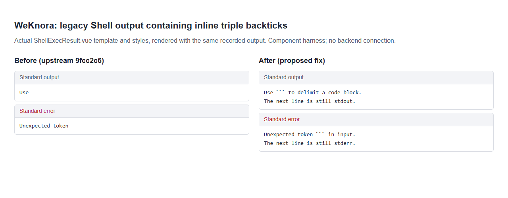

# WeKnora Shell output regression evidence

Screenshot of the actual `ShellExecResult.vue` template and styles from
[Tencent/WeKnora](https://github.com/Tencent/WeKnora), rendered in a local component harness.
The left side uses upstream `9fcc2c674309b42a1d4077e6b4c2a2334d49e57c`'s
`buildShellExecView`; the right side uses the proposed inline-fence fix.
Both receive the same Markdown fixture containing inline triple backticks in stdout and stderr.

The harness uses Vue server rendering and Chromium. It has no backend connection
and is not a screenshot of a deployed WeKnora instance.
The upstream template and styles are unchanged; only the parser differs.

Upstream's MIT license is included for attribution.
